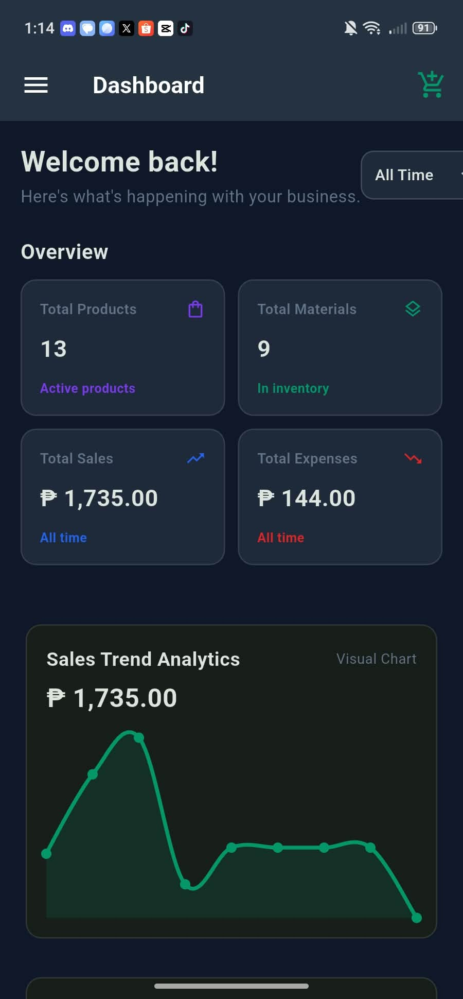
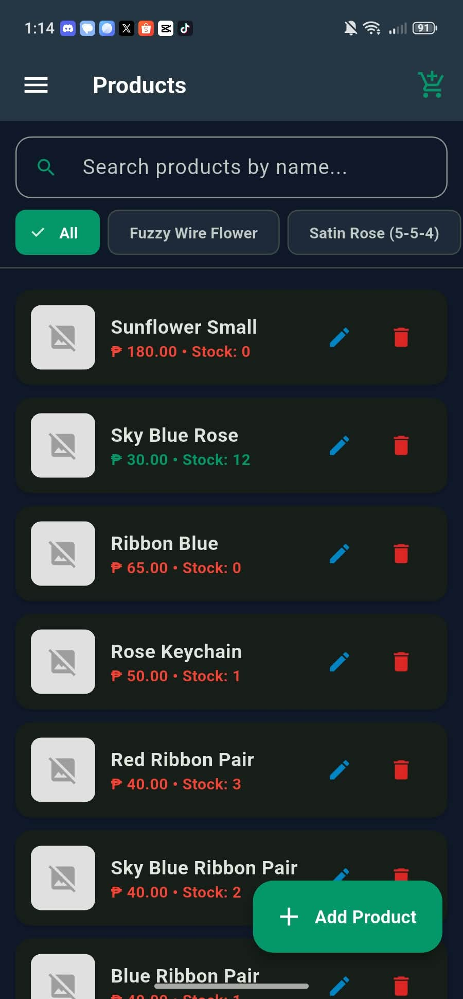
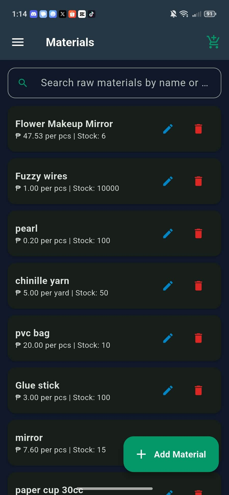
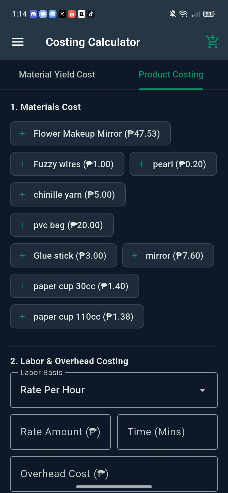
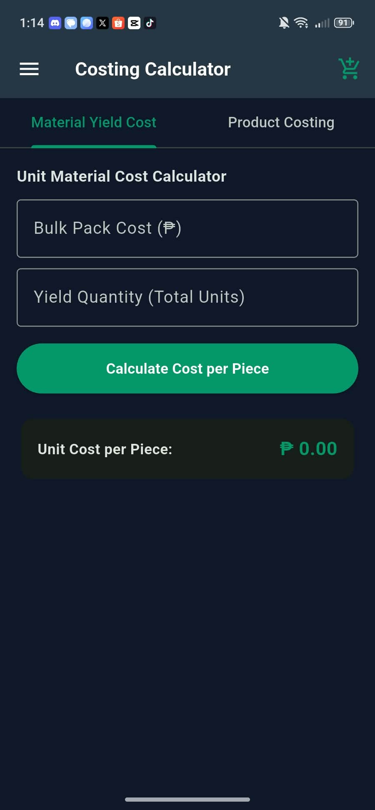
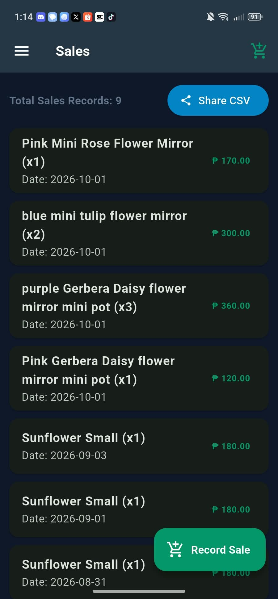
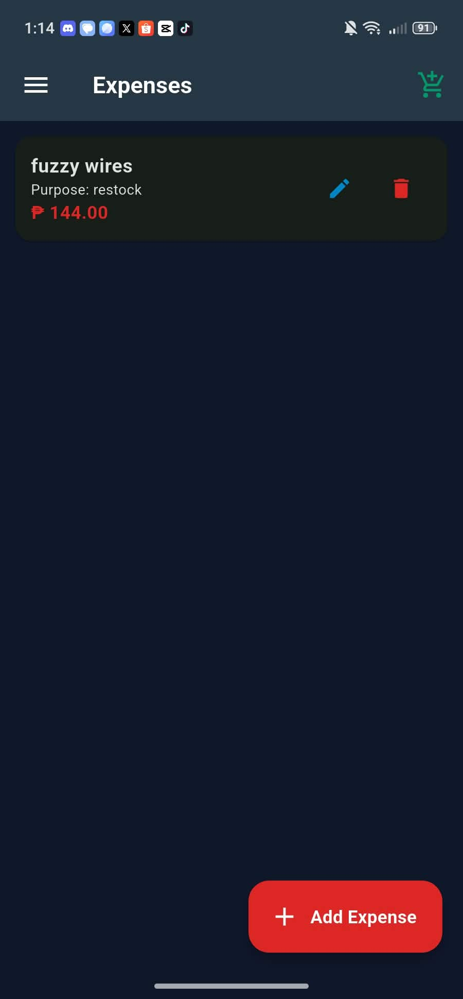
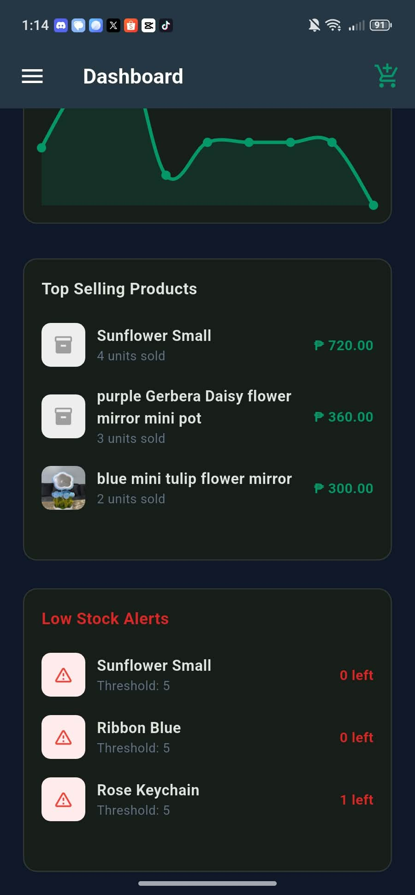

# StockWise

StockWise is a Flutter inventory and business-management app for small businesses. It brings products, raw materials, costing, sales, and expenses together in one place.

## Features

- **Dashboard:** Review product and material counts, sales and expenses, sales trends, top-selling products, and low-stock alerts. Filter sales and expense totals by today, this month, or all time.
- **Product inventory:** Keep product names, categories, prices, quantities, minimum-stock alerts, and optional photos organized.
- **Materials inventory:** Track raw materials, unit costs, and quantities on hand.
- **Costing calculator:** Estimate unit material cost from pack price and yield, or calculate a product's cost using materials, labor, and overhead.
- **Sales and expenses:** Record sales and business expenses, then review their histories.
- **CSV export:** Export and share a sales report.
- **Local data and theme preference:** App records and the selected theme are saved on the device. The app does not currently sync data to a cloud service.

## Screenshots

The screenshots below show the current app interface with example records.

<table>
  <tr>
    <td align="center"><br>Dashboard</td>
    <td align="center"><br>Products</td>
    <td align="center"><br>Materials</td>
    <td align="center"><br>Product costing</td>
  </tr>
  <tr>
    <td align="center"><br>Material yield</td>
    <td align="center"><br>Sales</td>
    <td align="center"><br>Expenses</td>
    <td align="center"><br>Sales insights</td>
  </tr>
</table>

## Built with

- Flutter and Dart
- `shared_preferences` for on-device storage
- `fl_chart` for dashboard charts
- `image_picker` for product photos
- `share_plus` for sharing exported sales reports

## Run locally

Install the [Flutter SDK](https://docs.flutter.dev/get-started/install), then run:

```sh
flutter pub get
flutter run
```

## Project status

This is a personal project that is still being developed. The repository contains the app source code; no public app release or hosted demo is currently provided.
